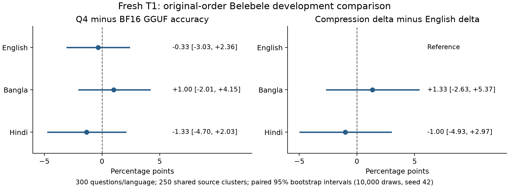

# Fresh T1 cold-runtime baseline results

Completed 23 October 2026. Both fresh arms contain 900 validated original-order development questions (300 each in English, Bangla and Hindi), collected under new identities after the accepted [A3 scoring decision](../../docs/scoring-contract-a3.md). This is a BF16 **GGUF** control versus local Q4_K_M comparison; the canonical original BF16 vLLM reference remains separate. No sweep, generation, phone or holdout measurement is reported.

Tiny Aya Global (3.35B, Cohere2), `CohereLabs/tiny-aya-global` revision `af89d219b53ed9b13b8a4645f9c8028973510324`; local Q4_K_M was built from the pinned BF16 without an importance matrix. These results do not cover all four-bit methods. The plain upstream prompt and one-space letter candidates use summed continuation likelihood, no appended EOS, one automatic BOS and first displayed maximum on an exact tie. Character normalization gives identical predictions for these one-character choices. These are **original-order accuracies, not A3 rotation means**.

## Fresh paired results

Intervals below are percentile 95% development-sample intervals from 10,000 jointly resampled source-cluster draws (250 source clusters, seed 42), preserving paired arms and shared sources across languages. They are conditional on this membership and contract. Values are percentages or percentage points (pp); correct counts have denominator 300.

| Language | BF16 correct; accuracy [95% CI] | Q4 correct; accuracy [95% CI] | Q4−BF16 pp [95% CI] | Delta minus English pp [95% CI] |
|---|---:|---:|---:|---:|
| English | 230; 76.67 [71.86, 81.36] | 229; 76.33 [71.62, 81.08] | -0.33 [-3.03, +2.36] | Reference |
| Bangla | 187; 62.33 [56.95, 67.81] | 190; 63.33 [57.88, 68.79] | +1.00 [-2.01, +4.15] | +1.33 [-2.63, +5.37] |
| Hindi | 184; 61.33 [55.97, 66.55] | 180; 60.00 [54.55, 65.46] | -1.33 [-4.70, +2.03] | -1.00 [-4.93, +2.97] |



All three fresh accuracy-difference intervals and both nontrivial English-relative interaction intervals include zero. This sample establishes neither equivalence/no harm nor a language-specific compression mechanism. Absolute English accuracy remains higher than Bangla and Hindi; that pre-existing gap is distinct from a compression interaction.

| Language | Changed choices; rate [95% CI] | Right→wrong | Wrong→right | Wrong→wrong |
|---|---:|---:|---:|---:|
| English | 21; 7.00% [4.30, 9.97] | 9 | 8 | 4 |
| Bangla | 33; 11.00% [7.62, 14.75] | 10 | 13 | 10 |
| Hindi | 34; 11.33% [7.90, 15.10] | 15 | 11 | 8 |

Bangla churn is 33/300 (11%) versus English 21/300 (7%), about 1.57×, **not doubled**. Small net accuracy changes conceal regressions, improvements and wrong-to-wrong changes. The full report retains source-paired intervals for each transition rate.

| Language | BF16 predicted A/B/C/D | Q4 predicted A/B/C/D | Gold A/B/C/D |
|---|---|---|---|
| English | 106/73/68/53 | 110/77/63/50 | 72/92/72/64 |
| Bangla | 137/65/54/44 | 129/70/56/45 | 72/92/72/64 |
| Hindi | 134/58/59/49 | 142/55/52/51 | 72/92/72/64 |

Letter histograms are descriptive. They do not correct scoring, identify an internal defect or establish position invariance; A3 separately measured position sensitivity.

## Historical A1 to fresh T1: same model arm, different runtime identity

Historical inputs are joined by exact source/question, targets and request/candidate bytes with matching model artifacts. Historical A1 numbers remain unchanged. These comparisons measure the **combined observed runtime/settings transition**; they do not isolate a patch or attribute changes to cache history alone. Each language has 1,200 paired candidate scores and 300 paired predictions per arm.

| Arm | Language | Historical→fresh correct | Changed predictions | R→W / W→R / W→W | Mean / maximum absolute candidate Δ (nats) | Mean margin Δ (nats) |
|---|---|---:|---:|---:|---:|---:|
| bf16-gguf | English | 230→230 | 0 | 0 / 0 / 0 | 0.00884 / 0.12155 | +0.00225 |
| bf16-gguf | Bangla | 188→187 | 1 | 1 / 0 / 0 | 0.01517 / 0.20342 | +0.00082 |
| bf16-gguf | Hindi | 184→184 | 0 | 0 / 0 / 0 | 0.01158 / 0.12355 | -0.00035 |
| local-q4 | English | 226→229 | 7 | 1 / 4 / 2 | 0.11403 / 0.89890 | -0.01269 |
| local-q4 | Bangla | 189→190 | 12 | 4 / 5 / 3 | 0.13871 / 1.33790 | +0.01696 |
| local-q4 | Hindi | 176→180 | 10 | 2 / 6 / 2 | 0.12054 / 0.79041 | +0.01602 |

The report retains signed/absolute candidate-score and top-two-margin distributions, empirical quantiles, per-question records and same-arm outcome intervals. Observed maxima are sample descriptions, not universal numerical bounds. In particular, the full-900 Q4 maxima above can exceed the earlier selected 15-context bridge maximum (0.42425 nats); those are different coverage sets.

## Fresh margin association (exploratory)

Margin is the fresh BF16 top-two summed-score difference. Bins were implemented before this collection; the following counts describe association, without causal adjustment, confirmatory interaction testing or a claim that margin explains away language.

| Language | BF16 margin <1 nat | Flips within <1 nat | Flips within ≥1 nat |
|---|---:|---:|---:|
| English | 38/300 | 15/38 | 6/262 |
| Bangla | 82/300 | 28/82 | 5/218 |
| Hindi | 83/300 | 29/83 | 5/217 |

All five bin counts/rates are retained in `fresh_margin.results`; historical margin analyses are separate evidence. Low-margin flips also occur in English, and larger margins do not eliminate flips.

## Validation, preservation and reproduction

- Both arms: 180 validated five-question shards, 900 exact identities, 3,600 finite candidate scores; frozen report exited 0. Both runners exited 0 and both owned servers were stopped, as recorded in the completed execution receipt.
- Expanded token checks and direct-logit/client/reversed-order gates are pinned by each saved identity. The full loader checks complete membership, targets, exact candidate order, requests, typed identity, runtime/client settings and evidence hashes.
- Conditional overlap with A3 covers 300 original-order requests per arm (2,400 candidate comparisons across both arms), with no failures or winner inversions. This is a compatibility check, not reuse of A3 rows to populate T1; freshly collected scores remain the evidence.
- Independent review reconstructed all 1,800 rows from 360 raw shards and independently recomputed fresh source-bootstrap endpoints. Archive creation verified all 379 original evidence members. This does not claim that every A3 variant interval was independently recomputed.

The [archive manifest](evidence/archive-manifest.json) indexes original/decompressed byte counts and SHA-256 hashes plus compressed archive hashes. It retains two arm archives (180 raw shards and original identity bytes each), 16 validation/provenance members and the frozen report. No model weights or request-lock payload are bundled; the lock location/hash and source/runtime pins remain explicit references. Identity bytes have newly captured archive hashes and exact typed-JSON equality to the report identity; the report did not previously bind an identity-file byte hash.

- [Complete frozen report](evidence/validated-report.json.gz): SHA-256 `c1ffee6b6030b1d5beb6c6afe3d855c1e1703df3e2fd6329270b06d55a1941a1` after decompression; 2,907,276 bytes.
- `validation.tar.gz` contains `validation/execution-record.json`: SHA-256 `905432e1c2e3158d7d579859a91e149cb3e924b331ac7dee613dfb7ba4b0da85`. It preserves the reviewed commands and working directory, frozen hashes, historical process history and explicit completion receipt. Local paths describe the historical machine; portable archive verification requires no extraction or original paths.
- [Packaging methodology](../../docs/t1-results-packaging.md), [T1 reporting contract](../../docs/t1-reporting-readiness.md), [A3 results](../a3-scoring-variants/README.md), [historical margin methodology](../../docs/margin-flip-analysis.md).

```sh
python -m scripts.archive_t1_baselines verify results/t1-cold-baselines/evidence --report-sha256 c1ffee6b6030b1d5beb6c6afe3d855c1e1703df3e2fd6329270b06d55a1941a1 --execution-record-sha256 905432e1c2e3158d7d579859a91e149cb3e924b331ac7dee613dfb7ba4b0da85
python results/t1-cold-baselines/render_figure.py
```

The figure renderer only reads the hash-checked complete report; it does not rerun scientific analysis. It requires Matplotlib. Exact original scientific report command and working directory are preserved in the archived execution receipt; do not substitute a changed checkout for its pinned source.

## Consequences and remaining gates

T1 supplies fresh affected full development comparators under the accepted plain-letter contract. It does not revise historical A1/A2/A3, replace the original vLLM reference or establish universal runtime parity. The tested cold-runtime gates have bounded coverage; the historical EOS 6 versus older EOS 3 discrepancy remains unresolved for future generation, which requires its own settings and protocol.

A4 human Bangla labels and confirmatory interaction review remain required before T3/B5; precision-sweep preregistration, real-build provenance, matched-byte/retention gates, blinded generation controls and protected holdout rules remain intact. No sweep or publication is authorized by this report. Article 1 still needs a reviewed source-backed runtime/exposure ledger, figure/claim review, provenance/privacy/license checks and the human author’s approval. These results support a reproducible measurement checkpoint, not a language mechanism or optimized allocation claim.
